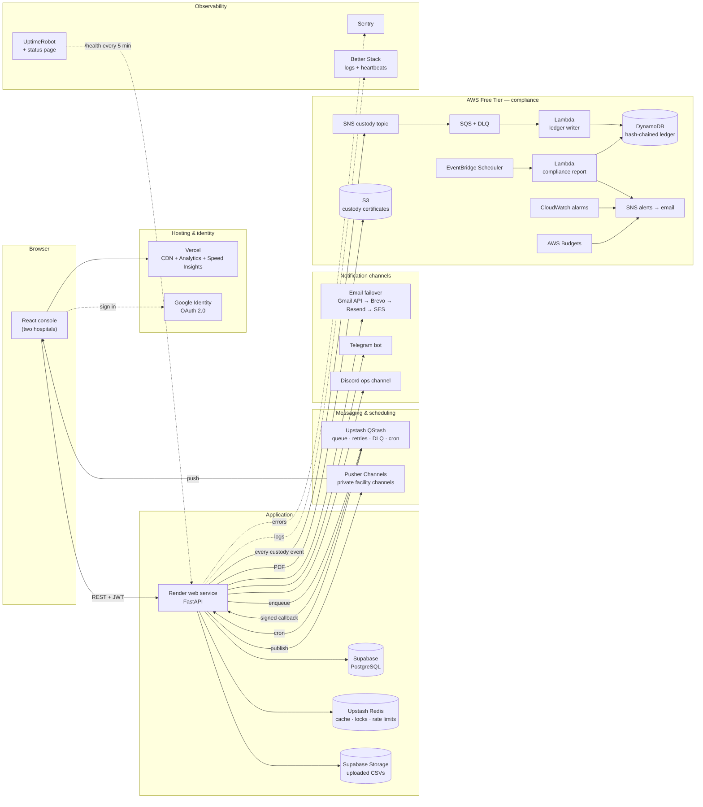
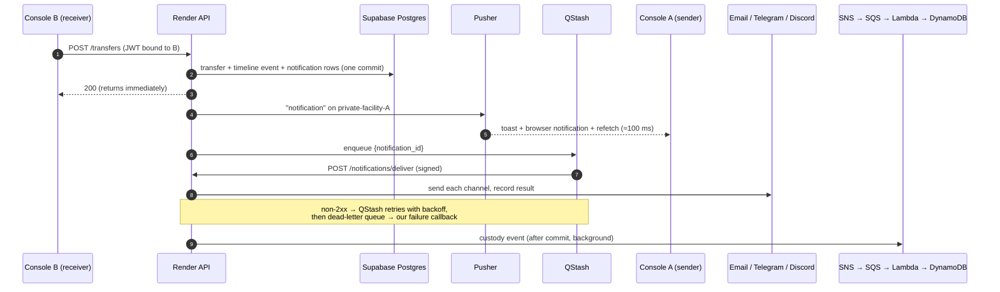

# PlateletIQ — Cloud services

PlateletIQ runs on **35 managed cloud services**, every one of them on a free tier.
Twenty-four are card-free; the eleven AWS services run inside the AWS Free Tier,
behind a US$1 budget alarm.

Each integration switches on from environment variables and **degrades
gracefully** when it is off. Nothing claims to be live unless it is: the API
computes every service's status at runtime, and the console's **Cloud services**
screen (and `GET /api/v1/system/integrations`) shows it, with a **Test** button
that exercises most services end to end.

- Setting the services up: [DEPLOYMENT.md](DEPLOYMENT.md)
- Showing them to someone: [DEMO_SCRIPT.md](DEMO_SCRIPT.md)
- The AWS stack on its own: [../aws/README.md](../aws/README.md)

---

## 1. Architecture

**Design rule:** the request that changes a transfer only writes to PostgreSQL and
returns. Everything slow or failure-prone — email, Telegram, Discord, the AWS
ledger, the PDF certificate — happens *after* the commit, off the request path,
with retries. A notification outage can never block, slow down or roll back a
custody step.

---

## 2. Every service at a glance

| # | Service | Category | What it does in PlateletIQ | Free tier used | AWS equivalent | Where |
|---|---|---|---|---|---|---|
| 1 | **Vercel** | Hosting | Builds and serves the React console from a global CDN on every push | Hobby plan | Amplify Hosting / S3 + CloudFront | `frontend/vercel.json` |
| 2 | **Vercel Web Analytics + Speed Insights** | Hosting | Page views and real-user Core Web Vitals | Hobby: 50k events/month | CloudWatch RUM | `frontend/src/App.tsx` |
| 3 | **Render** | Hosting | Runs the FastAPI backend with health checks and auto-deploy from GitHub | 750 instance-hours/month | App Runner / Elastic Beanstalk | `render.yaml` |
| 4 | **Render Blueprint** | IaC | The backend service and its environment as code | Free | CloudFormation | `render.yaml` |
| 5 | **Supabase PostgreSQL** | Data | System of record: facilities, inventory ledger, transfers, OTP digests, notifications | 500 MB database | RDS for PostgreSQL / Aurora Serverless | `backend/database.py` |
| 6 | **Supabase Storage** | Data | Keeps every uploaded demand-history CSV (forecast provenance); certificate fallback | 1 GB | S3 | `backend/cloud/storage.py` |
| 7 | **Upstash Redis** | Data | Route + network caches, once-a-day alert guards, delivery locks, rate limits | 500k commands/month | ElastiCache / MemoryDB | `backend/cloud/cache.py` |
| 8 | **Upstash QStash** | Messaging | Notification queue (3 retries → dead-letter queue) and cron scheduler | 1,000 messages/day, 10 schedules | SQS + Lambda, EventBridge Scheduler | `backend/cloud/qstash.py` |
| 9 | **Pusher Channels** | Messaging | Pushes changes to every open console of a facility on a private, signed channel | 200k messages/day, 100 connections | API Gateway WebSockets / AppSync | `backend/cloud/realtime.py`, `frontend/src/contexts/LiveContext.tsx` |
| 10 | **Gmail API** (Google Cloud) | Notifications | Primary email: alerts and the daily digest, sent as your own Gmail | Gmail sending limits | SES | `backend/cloud/email.py` |
| 11 | **Brevo** | Notifications | Email failover #2 | 300 emails/day | SES | `backend/cloud/email.py` |
| 12 | **Resend** | Notifications | Email failover #3 | 3,000/month, 100/day | SES | `backend/cloud/email.py` |
| 13 | **Telegram Bot API** | Notifications | Phone alerts per facility; `/stock`, `/transfers` commands; QR linking | Free | SNS mobile push | `backend/cloud/telegram.py`, `backend/services/telegram_links.py` |
| 14 | **Discord webhook** | Notifications | Network operations channel: every transfer across all hospitals | Free | SNS → AWS Chatbot | `backend/cloud/discord.py` |
| 15 | **Sentry** | Observability | Errors with stack traces, from API and browser, tagged by release | 5k errors/month | CloudWatch + X-Ray | `backend/cloud/observability.py`, `frontend/src/main.tsx` |
| 16 | **Better Stack Logs** | Observability | Searchable JSON logs that survive restarts | 3 GB/month, 3-day retention | CloudWatch Logs | `backend/cloud/observability.py` |
| 17 | **Heartbeats** (Better Stack / Healthchecks.io) | Observability | Alerts if a scheduled job stops running | 10 / 20 monitors | CloudWatch alarm on Scheduler metrics | `backend/cloud/heartbeat.py` |
| 18 | **UptimeRobot** | Observability | `/health` every 5 min, outage email, public status page | 50 monitors | CloudWatch Synthetics / Route 53 health checks | `backend/main.py` |
| 19 | **Google Identity (OAuth 2.0)** | Security | Sign-in; ID tokens verified against the audience | Free | Cognito (Google federation) | `backend/routers/auth.py` |
| 20 | **Doppler** | Security | All secrets per environment, synced to Render and Vercel | Developer plan | Secrets Manager / SSM Parameter Store | `doppler.yaml` |
| 21 | **Amazon SNS** | AWS | Fans out every custody event; emails alerts and the daily report | 1M publishes, 1,000 emails/month (always free) | — | `aws/plateletiq-aws.yaml`, `backend/cloud/aws.py` |
| 22 | **Amazon SQS** + DLQ | AWS | Buffers events for Lambda; poison messages to a dead-letter queue | 1M requests/month (always free) | — | `aws/plateletiq-aws.yaml` |
| 23 | **AWS Lambda** | AWS | Writes the hash-chained ledger; builds the daily compliance report | 1M requests/month (always free) | — | `aws/lambdas/` |
| 24 | **Amazon DynamoDB** | AWS | Independent, tamper-evident custody ledger | 25 GB, 25 RCU/WCU (always free) | — | `aws/plateletiq-aws.yaml` |
| 25 | **Amazon EventBridge Scheduler** | AWS | Runs the compliance report at 08:00 IST | 14M invocations/month | — | `aws/plateletiq-aws.yaml` |
| 26 | **Amazon S3** | AWS | Private, encrypted, versioned chain-of-custody PDFs | Free-plan credits | — | `backend/services/certificate_service.py` |
| 27 | **Amazon SES** | AWS | Email failover #4 | Free-plan credits (sandbox) | — | `backend/cloud/aws.py` |
| 28 | **AWS IAM** | AWS | Least-privilege user for the API; one role per Lambda and for the Scheduler | Free | — | `aws/plateletiq-aws.yaml` |
| 29 | **Amazon CloudWatch** | AWS | Lambda logs (14-day retention); alarms on DLQ depth and Lambda errors | 10 alarms (always free) | — | `aws/plateletiq-aws.yaml` |
| 30 | **AWS CloudFormation** | AWS | The whole AWS side as one uploadable template | Free | — | `aws/plateletiq-aws.yaml` |
| 31 | **AWS Budgets** | AWS | Emails at 80% of a US$1 monthly budget | Free | — | `aws/plateletiq-aws.yaml` |
| 32 | **GitHub + GitHub Actions** | DevOps | Source control; CI on every push; on-demand job runner | Free (public repo) | CodeCommit + CodeBuild + CodePipeline | `.github/workflows/` |
| 33 | **Docker + Compose** | DevOps | One command runs Postgres + API + console locally, like production | Free | ECR + ECS / Fargate | `backend/Dockerfile`, `docker-compose.yml` |
| 34 | **Mapbox / OSRM + OpenStreetMap** | Maps | Road routes and ETAs, map tiles for live tracking | OSRM/OSM free | Amazon Location Service | `backend/services/routing.py` |
| 35 | **Shiprocket** | Logistics | Courier booking, AWB, pickup and tracking webhooks (simulated without credentials) | — | — | `backend/services/transport/shiprocket.py` |

Already part of the project before this work: Google sign-in, Mapbox/OSRM
routing, Shiprocket, GitHub, and bare deployment configs for Vercel and
Render/Railway. Everything else is new.

---

## 3. What happens when a hospital asks for platelets

Hospital **B** is short and requests 12 SDP units from hospital **A**.

The same pipeline carries every step: authorised, picked up, arrived, settled.
On settlement a **chain-of-custody PDF** is rendered, stored in **S3**, and both
hospitals get the link.

**Who is told what**

| Step | Told | Severity |
|---|---|---|
| Requested (shortage pull) | the sender — it must act | by priority (EMERGENCY = critical, also to AWS alerts) |
| Offered (wastage push) | the receiver | by priority |
| Authorised, courier booked | the receiver | success |
| Declined / cancelled | the other side | warning / info |
| Courier booking failed | both (+ AWS alerts) | critical |
| Picked up | the receiver, with ETA | info |
| Courier arrived (webhook) | the receiver: redeem the code now | warning |
| Settled | both, with the certificate link | success |

One-time pickup and receipt codes are **never** sent through any channel; they
stay on the issuing facility's screen, exactly as the custody design requires
(and a test asserts it).

---

## 4. Service details

### Hosting & delivery

**Vercel** — the console is a static Vite build; Vercel builds it on every push to
`main`, serves it from its edge network with HTTPS, and gives each pull request a
preview URL. `frontend/vercel.json` adds the SPA fallback, long-lived caching for
hashed assets and security headers. The console detects Vercel itself (Vercel
exposes `VITE_VERCEL_ENV` and the commit SHA to Vite builds) and shows it on the
Cloud services screen.
*Show it:* the Vercel dashboard's deployment list; the release hash on the Cloud services screen.

**Vercel Web Analytics + Speed Insights** — `<Analytics />` and `<SpeedInsights />`
in `App.tsx`. Cookie-free page views and real-user LCP/INP/CLS.
*Show it:* Vercel project → Analytics / Speed Insights tabs.

**Render** — the API is a free web service built from `backend/` with
`pip install -r requirements.txt`, started with Uvicorn, and health-checked on
`/api/v1/health`. Free instances sleep after 15 minutes idle; QStash's schedules
and UptimeRobot's checks keep it warm during a demo. Render's free tier blocks
outbound SMTP and has an ephemeral disk, which is exactly why email goes over
HTTPS APIs and data lives in Supabase.
*Show it:* Render dashboard → Logs (one JSON line per request) and Events (deploys).

**Render Blueprint** — `render.yaml` declares the service, region (Singapore),
health check, Python version, generated secrets (`JWT_SECRET`, `OTP_SECRET`,
`JOBS_SECRET`) and the values to prompt for. Infrastructure as code for the PaaS
half of the system, as CloudFormation is for the AWS half.

### Data & storage

**Supabase PostgreSQL** — replaces local SQLite in the cloud. The app connects
through Supabase's **session pooler** (IPv4, works from Render) with the psycopg 3
driver; server-side prepared statements are disabled so the transaction pooler
works too. The schema is created and additively migrated on startup. The test
suite runs against PostgreSQL in CI.
*Show it:* Supabase → Table editor → `transfers`, `notifications`, `notification_deliveries`.

**Supabase Storage** — on **Data setup**, the uploaded CSV still trains the
forecast; the original file is now also archived to a private bucket at
`<facility>/demand-history/<timestamp>.csv`, so every recommendation can be traced
back to its input. It is also where certificates go when AWS is not deployed.
*Show it:* upload a CSV → the success card says where it was archived → Supabase → Storage.

**Upstash Redis** — serverless Redis over HTTPS (no connection to keep alive across
Render's sleep cycles). Used for:
- caching OSRM/Mapbox routes (6 h) and the eRaktKosh network summary (10 min);
- `SET NX EX` guards: one expiry alert per facility per day, one reminder per stale request;
- a 90-second lock per notification so two workers never send the same message twice;
- fixed-window rate limits on test buttons and manual job runs.

Without credentials it falls back to an in-process dictionary and says so.

### Messaging & scheduling

**Upstash QStash** — two roles:
1. *Queue.* After a commit the API publishes `{notification_id}`; QStash calls
   `POST /api/v1/notifications/deliver`. A 503 (some channel failed transiently)
   makes QStash retry with backoff; after 3 retries the message goes to QStash's
   dead-letter queue and its failure callback marks the notification `DEAD_LETTER`
   and raises an AWS alert. Delivery is idempotent — only `PENDING`/`FAILED`
   channels are retried.
2. *Cron.* Three schedules POST to `/api/v1/jobs/*`
   (`scripts/setup_qstash_schedules.py`).

Every inbound QStash call carries an `Upstash-Signature` JWT; the API verifies it
against the current and next signing keys **and a SHA-256 of the exact body**, so
the job and delivery endpoints cannot be forged or replayed.
Without QStash, delivery runs in a background thread and the hourly sweep
redrives anything stuck.

| Job | Schedule | What it does |
|---|---|---|
| `expiry-sweep` | hourly at :05 | retires expired units; warns each facility (once a day) about units expiring within 24 h; reminds senders about unanswered requests (EMERGENCY after 15 min); redrives stuck notifications |
| `daily-digest` | 08:00 IST | per-facility email + Telegram: stock, expiring units, transfers in progress, 7-day forecast, recommendation; network summary to Discord |
| `forecast-refresh` | 01:00 IST | re-runs the demand model for active facilities |

**Pusher Channels** — each facility has a private channel
`private-facility-<bank id>`. Browsers subscribe through `POST /api/v1/realtime/auth`,
which signs only the caller's own facility channel (a test proves a hospital
cannot subscribe to another's). Events: `notification` (toast, browser
notification, inbox refresh) and `transfer.updated` (refetch transfers and the
tracking map). With Pusher connected, the 2.5-second polling drops to a 20-second
safety net; the top bar shows *Live · Pusher* or *Polling*.

### Notifications

**Email: Gmail API → Brevo → Resend → Amazon SES.** `EMAIL_PROVIDERS` sets the
order; only configured providers take part. Each email tries them in turn and
stops at the first success; the delivery log records which provider sent it and
whether it failed over. Why four:
- **Gmail API** sends *as your own Gmail address*, so Google signs it and it lands in
  the inbox — the best option without owning a domain.
- **Brevo** mails anyone (300/day), but without your own domain it rewrites a Gmail
  sender and mail may land in spam.
- **Resend** without a verified domain only mails the account owner.
- **SES** in the sandbox only mails verified addresses.

Recipients are the facility's **signed-in members** plus extra addresses added on
the Notifications screen. The registry's public hospital addresses are never used.
`EMAIL_ALLOWLIST` can restrict delivery further during a demo.

**Telegram** — the Notifications screen shows a QR code for
`t.me/<bot>?start=<one-time code>`. Pressing *Start* sends `/start <code>`;
Telegram forwards it to `POST /api/v1/webhooks/telegram` (checked against
`X-Telegram-Bot-Api-Secret-Token`) and the chat is linked to that facility. Codes
expire after 30 minutes and are single-chat. The bot answers `/stock`,
`/transfers`, `/stop`. Locally, without a public URL, the console polls Telegram
instead.

**Discord** — one webhook URL; the network operations channel receives every
transfer step across all facilities, request reminders, dead-letter alerts and the
morning network summary, as colour-coded embeds.

**In-app inbox** — every notification is also a row the facility sees under
**Notifications**, with per-channel delivery chips (✓ Email via Gmail API,
✓ Telegram, ✕ with the error on hover).

### Observability

**Sentry** — `sentry-sdk[fastapi]` captures unhandled API errors and anything
reported from background work (failed deliveries, ledger publishes); the browser
SDK captures console errors behind an error boundary. No request bodies, cookies
or IPs are sent. Releases are tagged with the deployed commit.
*Show it:* Cloud services → Sentry → **Test** → Sentry → Issues.

**Better Stack Logs** — every request and notification event is one JSON line;
with a source token the same lines ship to Better Stack (search, live tail).
*Show it:* **Test** logs a marker line; search for it.

**Heartbeats** — each job pings `HEARTBEAT_URL_<JOB>` on success and `/fail` on
failure; Better Stack or Healthchecks.io alerts if a ping is late.

**UptimeRobot** — monitors `/api/v1/health` every 5 minutes and hosts a public
status page. The API remembers when UptimeRobot last called (by user agent), so
the Cloud services screen shows *"last check 3 min ago"* as proof.

### Security & identity

**Google Identity** — unchanged sign-in; ID tokens verified against Google with
an audience check, then a second step binds the session to a facility.

**Doppler** — `doppler.yaml` links `backend/` and `frontend/` to two Doppler
projects. Developers run `doppler run -- uvicorn main:app`; Doppler's Render and
Vercel integrations sync production values, so no secret is typed into a host
dashboard or committed. Secrets that must never reach the browser (Supabase
service-role key, AWS keys, provider API keys) live only in the API project;
the console only gets public values (`VITE_API_BASE_URL`, `VITE_SENTRY_DSN`).

### AWS compliance stack

Deployed from one file, [`aws/plateletiq-aws.yaml`](../aws/plateletiq-aws.yaml).

- **SNS → SQS → Lambda → DynamoDB.** The API does not call AWS from each endpoint:
  it listens to the database session itself (`backend/services/custody_stream.py`)
  and, **after** a transaction commits, publishes every new transfer-timeline event.
  The ledger can therefore only contain events that really happened, and it
  receives all of them — including courier webhooks.
- **Hash chain.** The Lambda writes each event as
  `hash_n = SHA-256(hash_{n-1} + payload_n)` per transfer, in one DynamoDB
  transaction that also claims the event id (so SQS redelivery is a no-op) and
  advances the chain head with an optimistic lock. Officers are pseudonymised.
- **Daily compliance report.** EventBridge Scheduler runs a second Lambda at 08:00
  IST that re-verifies every touched chain end to end and emails the summary via
  SNS. Editing any stored event breaks the chain and the report names the transfer
  (there is a test that does exactly this).
- **S3** keeps the PDF certificates: private, AES-256, versioned, TLS-only; links
  are presigned and expire.
- **IAM**: the API's user may only `sns:Publish` to two topics, `s3:PutObject/GetObject`
  under two prefixes, and `ses:SendEmail`. Each Lambda and the Scheduler has its own
  narrowly scoped role.
- **CloudWatch** alarms on DLQ depth and Lambda errors; **AWS Budgets** emails at
  80% of US$1.

New AWS accounts get a six-month free plan with up to US$200 in credits, and
always-free services remain available after it
([AWS announcement](https://aws.amazon.com/about-aws/whats-new/2025/07/aws-free-tier-credits-month-free-plan/)).
Everything in this stack is sized for the always-free limits (provisioned
DynamoDB capacity, 128 MB ARM Lambdas, 14-day log retention).

### DevOps

**GitHub Actions** — `ci.yml` runs on every push and PR: API tests against
PostgreSQL *and* SQLite, the AWS pipeline tests under moto, a check that the
rendered CloudFormation template is current, `cfn-lint`, the production console
build, and both Docker images. `run-job.yml` runs any scheduled job on demand.

**Docker + Compose** — `docker compose up --build` starts PostgreSQL, the API and
the console (nginx) on one machine, matching production.

---

## 5. Reliability and security, in one place

| Concern | How it is handled |
|---|---|
| Slow or failing providers | Off the request path; QStash retries with backoff; dead-letter queue + alert; hourly redrive |
| Duplicate sends | Per-channel delivery status; Redis lock per notification; QStash deduplication id |
| Duplicate ledger writes | DynamoDB transaction claims the event id; SQS redelivery is a no-op |
| Forged callbacks | QStash JWT + body hash; Telegram secret header; Shiprocket HMAC; `JOBS_SECRET` |
| Cross-facility snooping | Pusher private channels signed only for the caller's own facility |
| Custody codes leaking | Never placed in any notification (tested) |
| Real hospitals emailed by mistake | Registry addresses never used; members only; optional allowlist |
| Tampering with history | Hash-chained ledger outside the app's database, verified daily |
| Secrets | Doppler; server-only keys never in `VITE_*`; generated secrets on Render |
| Least privilege | IAM user and roles scoped to single resources |
| Surprise bills | Free tiers only; AWS Budget alarm at US$0.80 |
| A quota running out mid-demo | Email failover across four providers; rate-limited test buttons |

## 6. What runs with nothing configured

| Missing | What happens instead |
|---|---|
| Supabase | SQLite on local disk (fine on a laptop) |
| Upstash Redis | in-process cache |
| QStash | background-thread delivery; jobs run from GitHub Actions or the console |
| Pusher | 2.5-second polling, labelled *Polling* |
| Every email provider | in-app inbox, Telegram and Discord still work |
| AWS stack | no ledger; certificates rendered on demand (or stored in Supabase) |
| Sentry / Better Stack | logs to stdout (Render dashboard) |
